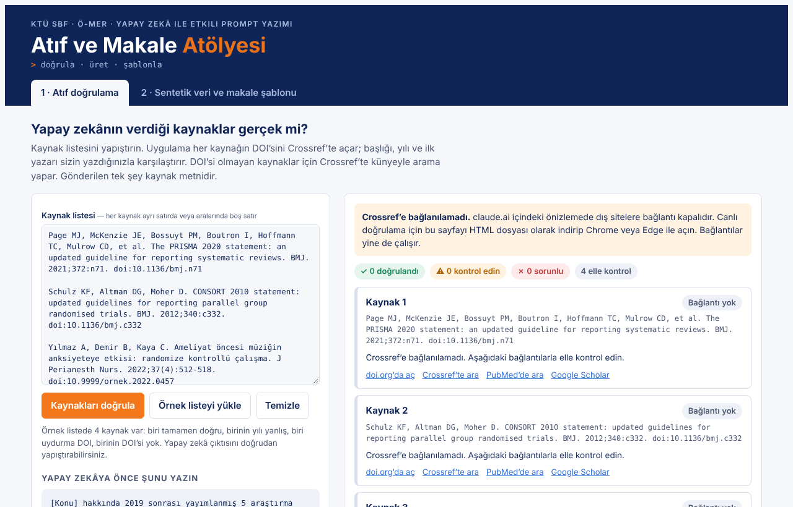
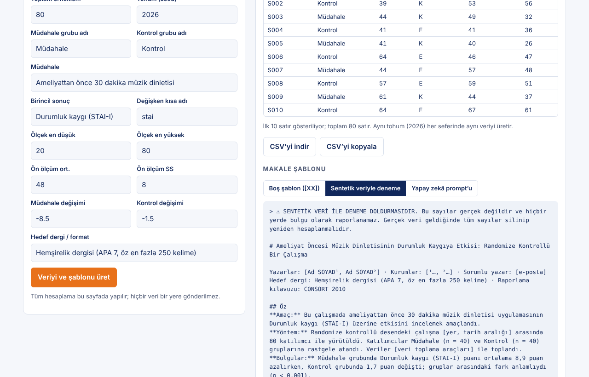

# Yapay Zekâ ile Etkili Prompt Yazımı Eğitimi

**KTÜ Sağlık Bilimleri Fakültesi · KTÜ Öğretme ve Öğrenme Merkezi (Ö-MER)**
30 Ekim 2026, Cuma · 14.00 · KTÜ SBF Prof. Dr. Rasim Özyavuz Toplantı Salonu

Eğitmen: **Doç. Dr. Tolga BERBER** — KTÜ Fen Fakültesi, Bilgisayar Bilimleri

> `> rol · bağlam · görev · çıktı`

Bu depo, eğitimde kullanılan sunumu, katılımcı uygulama notlarını, atölye uygulamasını ve örnek sentetik veriyi içerir.

## İçerik

| Klasör | Dosya | Açıklama |
|---|---|---|
| [`sunum/`](sunum/) | [Etkili_Prompt_Yazimi_Sunum.pdf](sunum/Etkili_Prompt_Yazimi_Sunum.pdf) | Eğitim sunumu (54 slayt, 16:9) |
| [`uygulama-notlari/`](uygulama-notlari/) | [Etkili_Prompt_Yazimi_Uygulama_Notlari.pdf](uygulama-notlari/Etkili_Prompt_Yazimi_Uygulama_Notlari.pdf) | Katılımcı kitapçığı (19 sayfa, A4): alıştırmalar, prompt kütüphanesi, boş PRISMA şablonu |
| [`atolye-uygulamasi/`](atolye-uygulamasi/) | [index.html](atolye-uygulamasi/index.html) | Atıf ve Makale Atölyesi (tarayıcıda çalışan araç) |
| [`veri/`](veri/) | [SENTETIK_ameliyat_oncesi_muzik_veri.csv](veri/SENTETIK_ameliyat_oncesi_muzik_veri.csv) | Eğitim amaçlı sentetik veri (80 hasta) |

## Sunumun bölümleri

1. **Yapay zekâya ilk adım** — sohbet asistanı nedir, nasıl çalışır, nasıl başlanır
2. **Dört parçalı çerçeve** — Rol · Bağlam · Görev · Çıktı
3. **Daha iyi sonuç için 5 alışkanlık** — örnek gösterme, önce plan, yineleme, kaynağa bağlı kalma, meta-prompt
4. **Atıf doğrulama: DOI ve Crossref** — doi.org, Crossref Simple Text Query, geri çekilme kontrolü
5. **Sentetik veri ile makale şablonu** — veri sözlüğü → sentetik veri → IMRaD şablonu
6. **PRISMA 2020 ile sistematik derleme** — PICO, arama stratejisi, akış diyagramı
7. **Sınırlar, etik ve KVKK**
8. **Uygulama**

## Atıf ve Makale Atölyesi

Kurulum gerektirmeyen, tek dosyalık bir web aracı. [`atolye-uygulamasi/index.html`](atolye-uygulamasi/index.html) dosyasını indirip Chrome veya Edge ile açın.

**1 · Atıf doğrulama.** Yapay zekânın verdiği kaynak listesini yapıştırın. Her DOI Crossref’te açılır; başlık, yıl ve ilk yazar sizin künyenizle karşılaştırılır. DOI’si olmayan kaynaklar için Crossref’te künyeyle arama yapılır ve geri çekilme kaydı kontrol edilir. Sonuç: ✓ doğrulandı · ⚠ kontrol edin · ✗ sorunlu.

**2 · Sentetik veri ve makale şablonu.** Desen, örneklem, gruplar ve beklenen etkiyi girin. Aynı tohum (seed) her seferinde aynı sentetik veriyi üretir; özet istatistikler hesaplanır, veri CSV olarak indirilir ve IMRaD makale şablonu üç görünümde hazırlanır: boş ([XX]), sentetik veriyle deneme, yapay zekâ prompt’u.

Atıf doğrulama için internet bağlantısı gerekir (yalnızca `api.crossref.org` sorgulanır). Makale sekmesindeki tüm hesaplamalar tarayıcıda yapılır; hiçbir veri gönderilmez.

## ⚠ Sentetik veri hakkında

`veri/` klasöründeki dosya ve atölye uygulamasının ürettiği veriler **gerçek hiçbir kişiye ait değildir**. Yalnızca makale şablonu hazırlamak, analiz planını denemek ve eğitim amacıyla kullanılabilir. Sentetik veriden elde edilen sayılar **hiçbir zaman bulgu olarak raporlanamaz**; bu, bilimsel yayın etiğinde veri uydurma (fabrication) sayılır.

## Faydalı adresler

- DOI açma: <https://doi.org>
- Crossref arama: <https://search.crossref.org>
- Crossref Simple Text Query (toplu kaynak eşleştirme): <https://apps.crossref.org/SimpleTextQuery>
- PubMed: <https://pubmed.ncbi.nlm.nih.gov>
- MeSH: <https://www.ncbi.nlm.nih.gov/mesh>
- PRISMA 2020: <https://www.prisma-statement.org>
- Mermaid diyagram düzenleyici: <https://mermaid.live>

## Kaynak

Page MJ, McKenzie JE, Bossuyt PM, et al. The PRISMA 2020 statement: an updated guideline for reporting systematic reviews. *BMJ.* 2021;372:n71. doi:[10.1136/bmj.n71](https://doi.org/10.1136/bmj.n71)

## Düzenleme Kurulu

**KTÜ Öğretme ve Öğrenme Merkezi (Ö-MER)** — Öğr. Gör. Dr. Memnüne KOKOÇ (Koordinatör), Öğr. Gör. Dr. Yasemin GÜNER (Koordinatör Yardımcısı)

**KTÜ SBF Mesleki Eğitim ve Gelişim Komisyonu** — Dr. Öğr. Üyesi Bahar ÇOLAK (Komisyon Başkanı), Dr. Öğr. Üyesi Gül ÇAKIR ÖZMEN, Arş. Gör. Dr. Nurdan Tuğçe GÜNAL, Arş. Gör. Yasemin YÖNEM, Arş. Gör. Zeynur EŞ, Arş. Gör. Ayşegül YILMAZ, Arş. Gör. Şura DAL SEVİM
